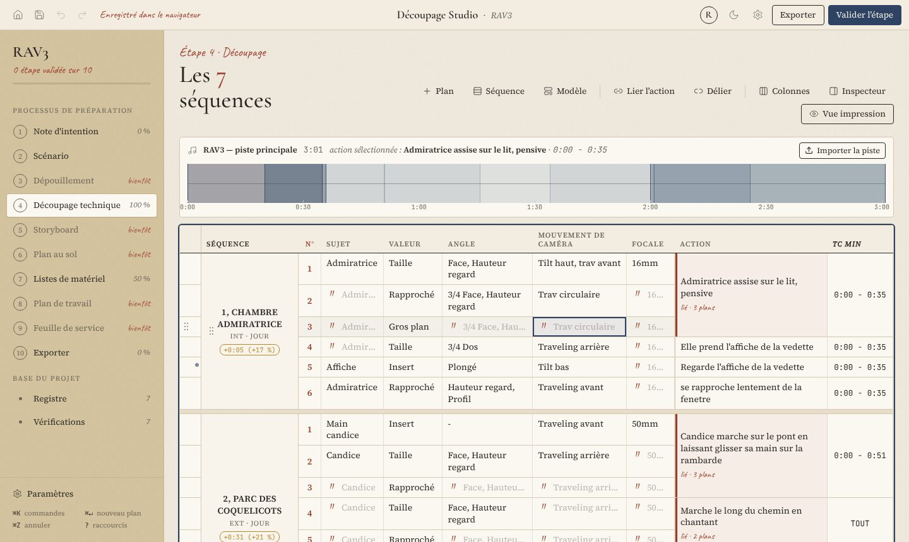
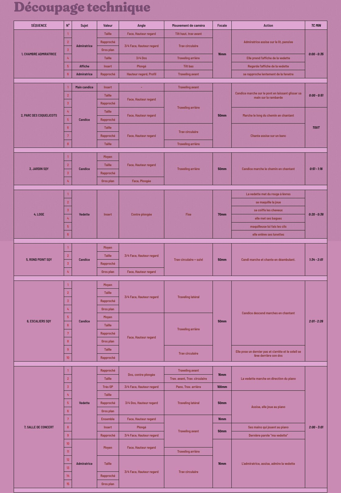
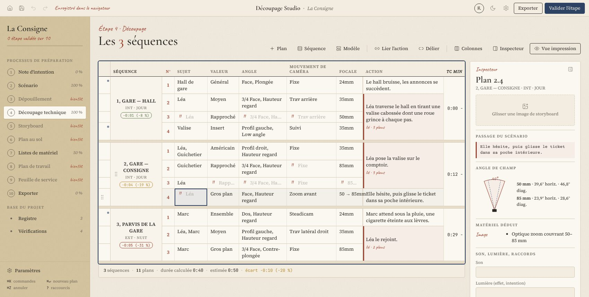
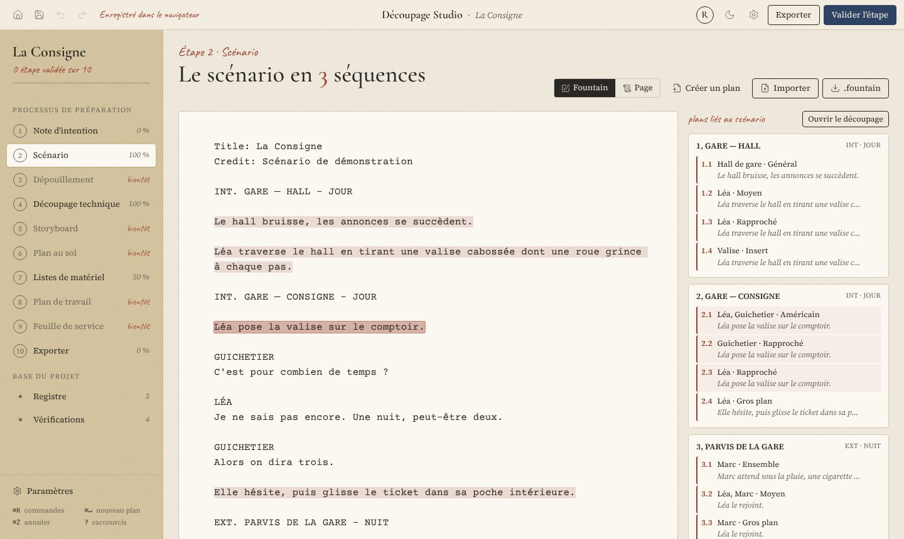
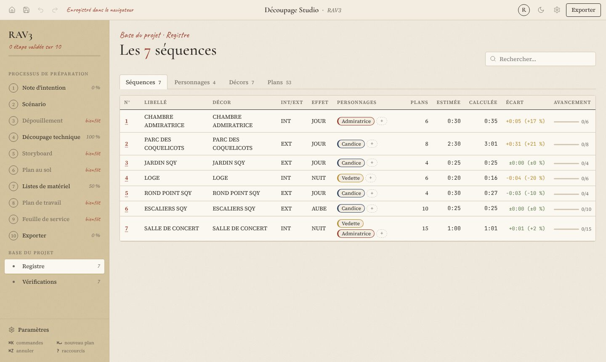
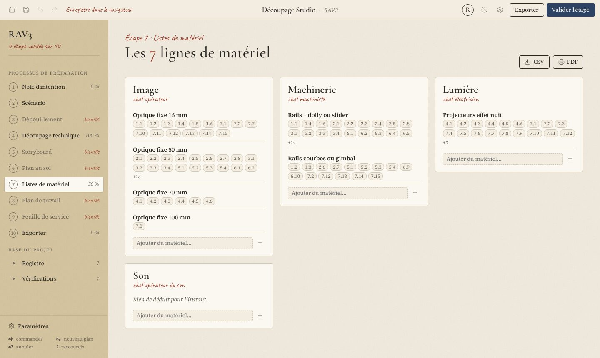
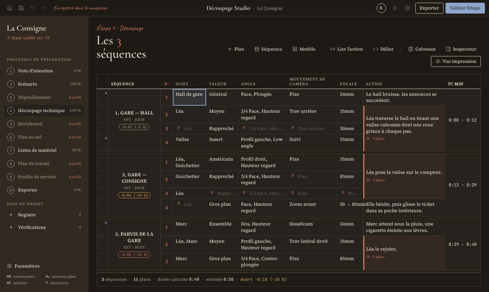

# Découpage Studio

**L’outil de découpage technique du réalisateur et de son chef opérateur.** Une grille vivante qui numérote, minute et fusionne toute seule, connaît le vocabulaire du cadre, tient le registre des séquences, personnages et décors, et produit un export PDF fidèle au tableau mauve de référence.

Application 100 % navigateur, *local-first* : aucun compte, aucun serveur. Les projets vivent dans le navigateur (IndexedDB) et s’échangent sous forme de fichiers `.decoupage`.



---

## Ce que l’outil fait pour chaque lecteur du découpage

| Lecteur | Ce qu’il y trouve |
|---|---|
| **Réalisation, image** | Une saisie façon tableur, au clavier, avec suggestions (valeurs, axes, angles, mouvements, focales), aperçu des fusions « 〃 », angle de champ calculé pour le capteur du projet. |
| **Scripte** | Un pré-minutage automatique (une action couverte par trois plans ne compte qu’une fois), la comparaison durée estimée / calculée, des contrôles de continuité non bloquants. |
| **1er assistant** | Le registre des séquences, décors et personnages, la durée à tourner par décor, des filtres par valeur, focale, comédien ou jour. |
| **Chefs de poste** | Les listes de matériel déduites des plans (Image, Machinerie, Lumière, Son), avec les plans concernés. |

## Fonctionnalités

- **Grille de découpage** : séquences fusionnées verticalement, numérotation toujours dérivée de l’ordre, navigation clavier complète, copier-coller depuis Excel ou Sheets, glisser-déposer des plans et des séquences avec renumérotation en direct, annuler / rétablir (150 pas).
- **Saisie intelligente** : popover de suggestions sans accents ni casse, jetons pour l’angle et le mouvement (séparateur « , » ou « + » préservé), focale verrouillée en mm qui se dédouble « de … à … » dès qu’un zoom apparaît, saisie tolérante du TC (`130` → 1:30, `1m30`, `tout`).
- **Couverture d’une action** : « Lier l’action » sur plusieurs plans consécutifs ; le temps d’écran n’est compté qu’une fois. Un déplacement qui casse la contiguïté scinde le bloc (annulable).
- **Minutage** : mode cumulatif (fiction) ou mode piste (clip) avec import de la piste audio, forme d’onde et calage des actions par glisser ; override manuel « ✎ ».
- **Export** : PDF (vue d’impression, A4 ou A3 paysage, thèmes Mauve, Papier, Sobre), Excel avec fusions et onglet « Registre », CSV, JSON ; import CSV avec assistant de correspondance des colonnes.
- **Registre** : séquences, personnages (fusion des doublons par glisser-déposer), décors, plans.
- **Inspecteur du plan** : cône d’angle de champ, matériel déduit, storyboard, son, lumière, notes de raccord, passage du scénario lié.
- **Scénario Fountain** : chaque en-tête crée une séquence, chaque personnage parlant une fiche ; sélectionner un passage puis clic droit → « Créer un plan avec cette action ».
- **Modèles de séquence** : documentaire, interview institutionnelle, clip (performance, narratif).
- **Confort** : palette de commandes `⌘K`, aide des raccourcis `?`, thème sombre « Encre », application installable et utilisable hors ligne.

| | |
|---|---|
|  |  |
| *Export PDF fidèle à la référence (thème Mauve)* | *Inspecteur : angle de champ, matériel, raccords* |
|  |  |
| *Scénario Fountain : passages liés aux plans* | *Registre : estimé, calculé, écart, avancement* |
|  |  |
| *Listes de matériel par chef de poste* | *Thème sombre « Encre »* |

## Raccourcis essentiels

| Raccourci | Action |
|---|---|
| `Entrée` / `Tab` / `Échap` | Éditer et descendre / cellule suivante / annuler |
| `⌘↵` / `⌘⇧↵` | Nouveau plan / nouvelle séquence |
| `⌘D` / `⌘⌫` | Dupliquer / supprimer le plan |
| `⌥↑ ⌥↓` / `⌥⇧↑ ⌥⇧↓` | Déplacer le plan / la séquence |
| `⌘⇧↓` | Recopier vers le bas |
| `⌘Z` / `⌘⇧Z` | Annuler / rétablir |
| `⌘S` | Enregistrer le fichier `.decoupage` |
| `⌘K` / `?` | Palette de commandes / aide |

Sous Windows et Linux, `⌘` correspond à `Ctrl`.

## Démarrer

```bash
npm install
npm run dev          # http://localhost:5173
```

Deux projets de démonstration se chargent depuis l’accueil : **RAV3** (clip, transcription exacte de l’export de référence) et **La Consigne** (fiction courte avec scénario et dialogues).

## Scripts

| Commande | Rôle |
|---|---|
| `npm run dev` | Serveur de développement |
| `npm run test` | Tests unitaires (Vitest) |
| `npm run test:coverage` | Couverture du domaine (`src/domain`) |
| `npm run test:e2e` | Parcours Playwright (Chromium headless) ; produit `test-results/export-rav3.png` et `.pdf` |
| `npm run build` | Vérification TypeScript + build de production |
| `npm run lint` | ESLint |

## Déploiement

Le workflow `.github/workflows/deploy.yml` construit et publie l’application sur **GitHub Pages** à chaque push sur `main`. Le chemin de base vaut `/<nom-du-dépôt>/` ; il se règle avec la variable de dépôt `BASE_PATH` (ou la variable d’environnement du même nom en local). Activez Pages dans *Settings → Pages → Source : GitHub Actions*.

Le workflow `.github/workflows/ci.yml` lance lint, tests unitaires, build et tests de bout en bout sur chaque pull request.

## Architecture

```
src/
  domain/     fonctions pures et testées : types, vocabulaire, timecode, minutage, fusions,
              matériel, contrôles, Fountain, CSV, sérialisation, modèles
  store/      Zustand + immer + zundo, persistance Dexie, fichiers .decoupage
  features/   grille, export, registre, inspecteur, scénario, vérifications, matériel, shell
  ui/         primitives maison (boutons, suggestions, tables, dialogues, toasts)
  styles/     jetons de couleur, papier, impression
seed/         projets de démonstration RAV3 et La Consigne
e2e/          parcours Playwright
```

Stack : Vite, React 18, TypeScript strict, Zustand, immer, zundo, Dexie, dnd-kit, ExcelJS, lucide-react ; polices Cormorant Garamond, Source Serif 4, Caveat, Fraunces, Barlow Semi Condensed, Courier Prime et JetBrains Mono (auto-hébergées).

La spécification complète se trouve dans [`SPEC.md`](SPEC.md), l’avancement dans [`PROGRESS.md`](PROGRESS.md) et les arbitrages dans [`DECISIONS.md`](DECISIONS.md).
